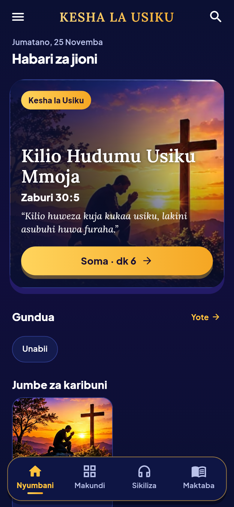

# Kesha la Usiku (Mate Generous App)

A Christian digital library with **Kesha la Usiku** as its flagship nightly devotional, plus Asubuhi ya Tumaini, Weary Souls, Marriage & Family, Unabii, the Sermon Library and more.

The admin creates, renames, reorders, publishes or archives categories, series and home-screen sections from the dashboard. Nothing is hard-coded in the app, so a new department never needs a new app release.

## Repository layout

| Folder | What it is | Status |
| --- | --- | --- |
| `backend/` | Django + REST API + admin dashboard, media on Supabase Storage | Phase One built, 46 tests passing |
| `mobile/` | Flutter Android app (iOS in Phase Two from the same code) | Approved template design, offline-first cache, Swahili/English, audio player, forgot password; 15 tests passing |
| `docs/` | Architecture, API and payment decisions | |



## Phase One scope (agreed)

| # | Item | Where |
| --- | --- | --- |
| 1 | UI/UX design: app and admin | `mobile/`, admin theme (Unfold) |
| 2 | App contents: home, reader, categories & series, My Library, bookmarks & favourites, dark mode, font size | `mobile/lib/screens/` |
| 3 | Secure backend & API | `backend/` |
| 4 | Admin dashboard: users, devotionals, categories, series, audio, subscriptions, publishing & archiving | `/admin/` |
| 5 | Registration & My Library: login, profile, saved content, reading history | `/api/auth/`, `/api/library/` |
| 6 | Devotional reader: Scripture, text, headings, images, prayer/application, next/previous | `/api/contents/<slug>/` |
| 7 | Subscription engine: Free, Monthly, Quarterly, 6 Months, Annual, Premium, expiry & entitlements | `apps/subscriptions` |
| 8 | Payments: M-Pesa, Airtel Money, Mixx by Yas, verification, records, activation | `apps/payments` (see `docs/PAYMENTS.md`) |

## Run the backend locally

```bash
cd backend
python3 -m venv ../.venv && . ../.venv/bin/activate
pip install -r requirements.txt
cp .env.example .env
python manage.py migrate
python manage.py createsuperuser
python manage.py runserver
```

- Admin dashboard: http://localhost:8000/admin/
- API: http://localhost:8000/api/
- From the Android emulator, the API is at `http://10.0.2.2:8000/api/`.

Run the tests:

```bash
cd backend && DJANGO_DEBUG=1 python manage.py test
```

Payments use the **sandbox** gateway until the real one is chosen. Sandbox numbers ending in `0000` fail, and every other number succeeds.

## Speed and offline use

The app is offline-first. On first launch it downloads home, departments, plans and the latest 60 messages in full, then every screen opens from the phone instantly and refreshes quietly in the background. If the server is asleep or there is no network, saved content still opens. Images are cached on the phone too.

Keep the free Render server awake with [UptimeRobot](https://uptimerobot.com): an HTTP(s) monitor on `https://<your-service>.onrender.com/health/` every 5 minutes.

## Deploy (staging)

`render.yaml` sets up a free Render web service with sandbox payments switched on for testing. The database is a free Supabase Postgres; Render asks for its connection string (`DATABASE_URL`) when the Blueprint is created. Android test builds run on Codemagic (`codemagic.yaml`): each push analyses, tests and builds a release APK, then emails it to testers.

More detail is in [`docs/ARCHITECTURE.md`](docs/ARCHITECTURE.md), [`docs/API.md`](docs/API.md) and [`docs/PAYMENTS.md`](docs/PAYMENTS.md).
